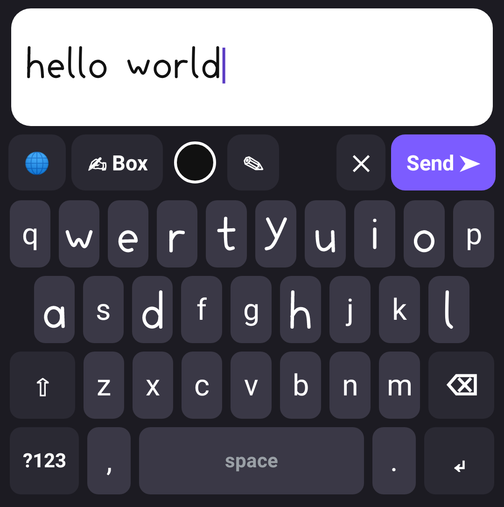
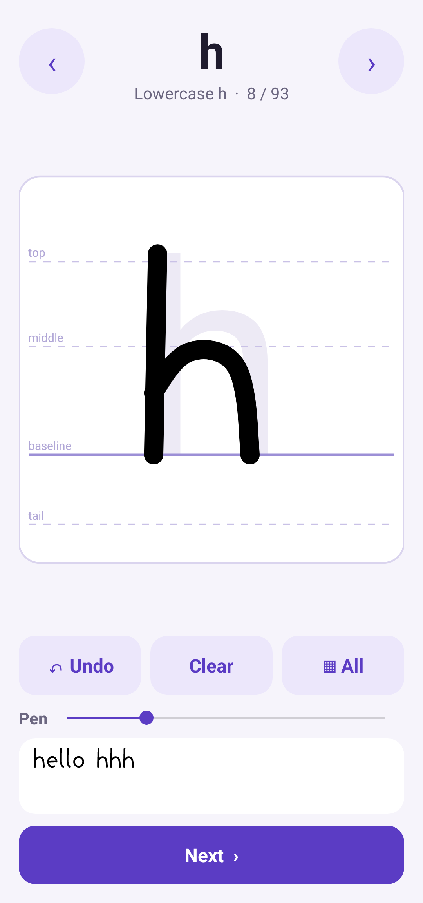

# Font Maker

An Android app that turns your handwriting into a font, plus a keyboard that types in it.

- **Draw your letters.** Draw each character (a–z, A–Z, 0–9 and symbols) on a guided canvas, with undo and pen thickness.
- **Font keyboard.** Type into the keyboard's box and your words show up in your handwriting. Tap **Send** and the message goes into the chat as a picture.
- **Export a real font.** Save your handwriting as a `.ttf` file.

| Keyboard | Sent message | Drawing |
|---|---|---|
|  |  |  |

## Install

1. Download [`dist/FontMaker.apk`](dist/FontMaker.apk) to your phone (or get the `FontMaker-apk` artifact from the latest GitHub Actions run).
2. Open it. If asked, allow installing apps from this source.
3. Open **Font Maker** and tap **Draw my letters**.

## Using the keyboard

1. In the app, tap **Step 1** and turn on **Font Maker Keyboard**. Android warns that keyboards can collect what you type. This one has no internet permission and keeps everything on the phone.
2. Tap **Step 2** and pick the font keyboard. Later you can switch keyboards with the 🌐 key or the keyboard icon in the navigation bar.
3. In any chat, type in the white box on the keyboard. It's written in your font.
4. Tap **Send ➤**.
   - In apps that accept pictures from keyboards (Google Messages and many others), the picture is put straight into the message box. Then tap the app's own send button.
   - In other apps, the share sheet opens. Pick the chat to send it to.

Keyboard buttons:

| Button | What it does |
|---|---|
| 🌐 | Switch to another keyboard |
| ✍ Box / abc | Box mode types into the handwriting box. **abc** mode types normal text straight into the app (handy for search bars). |
| ● | Change the ink colour |
| ✎ | Open Font Maker to draw more letters |
| ✕ | Clear the box |

Any character you haven't drawn yet is shown in a stand-in font.

## Build

```
./gradlew assembleRelease          # → app/build/outputs/apk/release/app-release.apk
./gradlew testDebugUnitTest        # TTF writer test + Robolectric screenshot tests (app/build/screens)
```

Requires JDK 17+ and the Android SDK (platform 34). The keystore in `signing/` is a public, non-secret key. It's there so every build installs as an update over the previous one.
